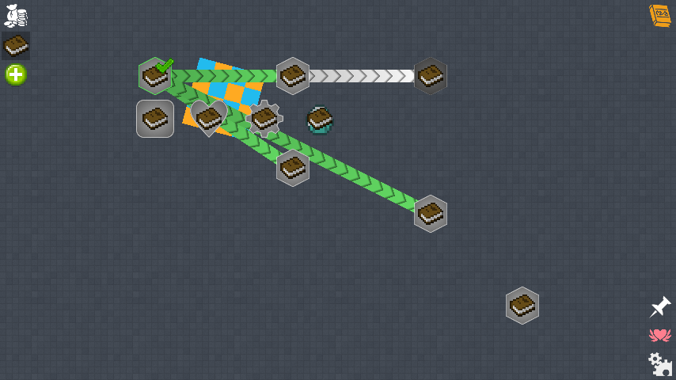
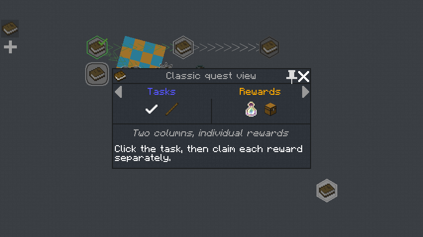
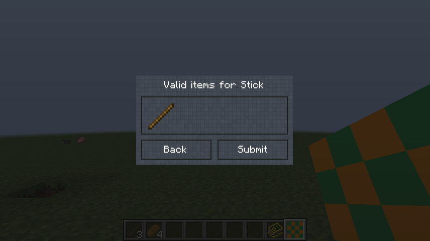
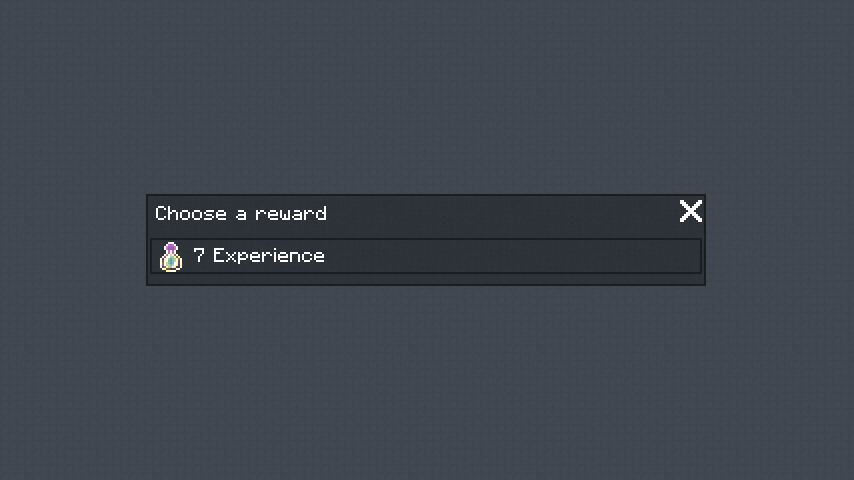

# Sigmarix Quests — Minecraft 1.7.10

Самостоятельная реализация функций квестовой системы под Forge 10.13.4.1614
и Java 8. Текущая сборка — 0.28.1-SNAPSHOT. Интерфейс сверяется с FTB Quests
1202.9.0.15 / FTBLib 5.4.7.2 для Minecraft 1.12.2, стандартная тема.
Пары снимков и воспроизводимые попиксельные проверки находятся в
[docs/PARITY_WORKLOG.md](docs/PARITY_WORKLOG.md). Поддерживается официальная
Botania r1.8-249; GTNH-моды не требуются. Границы переноса между версиями
Minecraft перечислены в [COMPATIBILITY.md](COMPATIBILITY.md).

Java-код FTB не включён. Начиная с 0.24 включены исходные текстуры FTB Quests
и FTBLib: источники и контрольные суммы перечислены в
[THIRD_PARTY_ASSETS.md](THIRD_PARTY_ASSETS.md). Исследован публичный исходник ветки `1.12`,
commit `85b7652bd69f3bc4c03ba9ba24909ddea0605a53`:
https://github.com/FTBTeam/FTB-Quests/tree/1.12
Официальная страница оригинала указывает All Rights Reserved:
https://www.curseforge.com/minecraft/mc-mods/ftb-quests-forge

В 0.28.1 исправлен слой выбора категорий: раскрытый список непрозрачен и
перекрывает узлы, иконки предметов и подсветку квестов. Кнопка «Команды» находится
на правой панели, чтобы не перекрывать первую категорию слева.

## Отдельная клиентская сборка

`quests1710-0.28.1-SNAPSHOT-client.jar` предназначен только для подключения к
серверу с полной версией 0.28.1. Удалите обычный JAR из клиентской папки `mods`
и положите вместо него клиентский. Вместе их устанавливать нельзя.
На сервере оставьте обычный JAR из того же релиза. В одиночном мире клиентская
сборка молча неактивна и не препятствует запуску игры. Для квестов в одиночной
игре нужен обычный JAR.

[Состав и проверка клиентского JAR](docs/CLIENT_ONLY.md).

## Русская книга для шести модов

Отдельный набор находится в [quest-packs/ru-six-mods-1.7.10](../quest-packs/ru-six-mods-1.7.10):
180 заданий, по 30 для AE2, Blood Magic, Thaumcraft, Botania, Witchery и IC2.
Шесть JSON-файлов загружаются из `config/sigmarixquests/chapters`; корневая книга
включает их через `chapterDirectory`. Квесты не включены в JAR и не заменяют
встроенные примеры при обычной установке мода. Инструкция — `УСТАНОВКА.txt` в наборе.
Отдельный ресурспак содержит 17 оригинальных игровых иллюстраций; его нужно
включить в клиенте. 139 заданий проверяют предметы без расходования, 41 задача
построек/исследований/испытаний явно подтверждается вручную.

В 0.26 встроен полный каталог русского перевода собственных окон, полей,
подсказок и сообщений, а также дополнены пропущенные строки FTB/FTBLib.
Названия команд, реестровые ID, пользовательский ввод и данные книги сохраняются
в исходном виде. Для перевода выберите русский язык Minecraft.

## Установка и книга

Установите `build/libs/quests1710-0.28.1-SNAPSHOT.jar` в `mods` Forge-клиента и сервера.
Требуется одна и та же версия мода на обеих сторонах: он добавляет блоки и предметы.
Клиент открывает GUI по `/questbook`, клавише `` ` `` или правому клику
книгой заданий. Книга крафтится без формы из обычной книги. Команды также позволяют
управлять заданиями без открытия GUI.
Файл `-dev.jar` предназначен для разработки, а не для установки в игру.

При первом запуске создаётся `config/sigmarixquests/quests.json` с четырьмя
примерами. Старая книга 0.1 читается с автоматической раскладкой узлов.
Существующий пользовательский файл не заменяется примером из JAR.

На карте работают главы, поиск, зависимости, перетаскивание карты, масштабирование
колесом, просмотр задач и наград, завершение, получение и повторение заданий.
Нажатие на узел открывает окно квеста по центру карты; колесо прокручивает его содержимое.
Escape закрывает сначала окно квеста, затем книгу. Главы выбираются значками слева;
при наведении раскрываются названия и дочерние главы. Ctrl+F открывает поиск.
Дополнительные действия (команды, обновление, выход) доступны через значок справа внизу. Награды с выбором открывают
отдельный экран с независимым выбором для каждого пункта.

Оператор уровня 2 может двигать узлы через Shift+перетаскивание. Edit book
открывает формы объектов: книга → главы/квесты → задачи/награды → вложенные поля.
Строки и числа редактируются отдельно, логические значения переключаются нажатием,
типы и режимы перебираются кнопкой Next value. Для переноса строки в текстовом поле
используйте `\n`. Списки поддерживают Add/Delete, Copy/Paste и Up/Down. Скопированные
квесты, задачи и награды получают новый ID. Изменения остаются локальным черновиком
до Save book. Права и все определения повторно проверяются сервером.

Кнопка Raw JSON открывает многострочный редактор текущего черновика: Ctrl+A/C/V,
Ctrl+Z, стрелки/Home/End, Tab и прокрутка. Полный JSON также доступен для редких
настроек и сложных массовых правок. Основные формы, контекстные меню и действия карты используют интерфейс FTB 1.12.2;
Raw JSON остаётся дополнительным редактором собственной схемы 1.7.10.

Сервер проверяет права и всю книгу перед сохранением. Предыдущая версия сохраняется
в `quests.json.bak`; запись использует временный файл и атомарную замену, если
файловая система её поддерживает. Изменившаяся на сервере версия книги блокирует
сохранение устаревшей копии: нужно обновить и снова открыть редактор.

## Команды

| Команда | Действие |
| --- | --- |
| `/quests` или `/quests list` | Задания и состояния |
| `/quests show <id>` | Требования и награды |
| `/quests start <id>` | Отметить квест начатым |
| `/quests task <id> <task>` | Подтвердить отдельную задачу check |
| `/quests check <id>` | Проверить и завершить задание |
| `/quests submit <quest> <task>` | Частично сдать предметы расходуемой задачи |
| `/quests claim <id> [choice ...]` | Получить награды; индексы выбора начинаются с 0 |
| `/quests repeat <id>` | Повторить повторяемое задание после задержки |
| `/quests reload` | Перечитать JSON, оператор/консоль |
| `/quests reset <id> <player>` | Сбросить задание онлайн-игроку, оператор/консоль |
| `/quests bind <quest> [task]` | Привязать устройство под прицелом, владелец/оператор |
| `/quests unbind` | Снять привязку устройства под прицелом |
| `/quests team info` | Показать группу |
| `/quests team create <name>` | Создать группу из личного прогресса |
| `/quests team invite <player>` | Пригласить онлайн-игрока, только лидер |
| `/quests team join <leader>` | Принять приглашение |
| `/quests team kick <player>` | Исключить участника, только лидер |
| `/quests team leave` | Покинуть группу; лидер использует disband |
| `/quests team disband` | Распустить группу, только лидер |

В группе общий прогресс. `rewardMode:"team"` (по умолчанию) выдаёт награду одному
участнику за группу; `rewardMode:"individual"` — каждому участнику отдельно.
Корневая награда может переопределить это через `mode:"team"`/`"individual"`;
`mode:"inherit"` наследует настройку квеста. Вложенные варианты наследуют корень.
Личные получения сохраняются по UUID. Для повторения группового квеста лидер
должен дождаться получения всех личных наград текущими участниками.
При выходе, исключении или роспуске заработанные состояния сливаются с личными;
уже полученные награды не становятся доступными повторно из-за смены группы.
Приглашения, лидерство и членство сохраняются в мире.

## Формат книги и задач

Корень: `format: 2`, `title`, `chapters`, `quests`, `lootTables`, `lootSettings`, `theme`, `styles`.
Глава содержит `id`, `title`, `description`. Квест содержит уникальный `id`,
`title`, `description`, `chapter`, `icon` (registry ID предмета), координаты `x/y`,
`dependencies`, `tasks`, `rewards`. Идентификаторы используют буквы, цифры, `_`,
`.` и `-`, длина до 64 символов. Задачи и корневые награды имеют собственный стабильный `id` (награды: `r0`, `r1` и т.д. по умолчанию).
Если он пропущен, присваивается `t0`, `t1` и т.д.; после начала игры сохраняйте
эти ID при перестановке задач. Числовые счётчики убийств 0.1 читаются при миграции.

Параметры квеста: `hidden`, `optional`, `repeatable`, `cooldownSeconds`,
`autoComplete`, `autoClaim`, `anyDependency`, `minDependencies`, `anyTask`.
По умолчанию нужны все зависимости и задачи. `anyTask` включает ИЛИ между задачами;
`minDependencies` задаёт число необходимых зависимостей. Формы ссылок:
`quest_id` или `quest:quest_id`, `task:quest_id/task_id`, `chapter:chapter_id`.
`dependencyState:"completed"` (по умолчанию) требует завершения;
`"started"` — начала/ненулевого прогресса. Глава завершена, когда завершены все
её обязательные квесты; `optional:true` исключает квест из этого
условия. Начало любого квеста отмечает главу начатой. Циклы ссылок запрещены.
Кнопка Tasks / start открывает подтверждения отдельных задач и начало квеста.

| `type` задачи | Основные поля и поведение |
| --- | --- |
| `check` | `manual:true` требует отдельного подтверждения; по умолчанию прежнее подтверждение проверкой квеста |
| `item` | `target`, `targets`, `count`, `meta`, `consume`, `ignoreDamage`, `nbt`, `nbtMode`, `craftingOnly` |
| `fluid` | `target` — имя FluidRegistry, `count` в mB; полные ёмкости, IFluidContainerItem и приём терминалом; `nbt`/`nbtMode` фильтруют NBT жидкости |
| `energy` | `count` в RF; приём терминалом с CoFH API |
| `botania_mana` | `count` в мане; IManaReceiver принимает реальные mana bursts, потраченная мана не доступна для извлечения |
| `buildcraft_mj` | Микро-MJ: 1 MJ = 1 000 000 единиц; BuildCraft 7.1.23 передаёт RF, пересчёт 1 RF = 100 000 микро-MJ. Последняя неполная RF-единица округляется вверх при приёме, прогресс ограничен целью |
| `emc` | Баланс ProjectE PE1.10.1; `count`, `consume`, частичная сдача через GUI |
| `npc_quest` | `target` — числовой ID строкой; `checkActive:true` проверяет активный, иначе завершённый NPC-квест |
| `npc_dialog` | `target` — ID прочитанного диалога CustomNPCs |
| `npc_faction` | `target` — ID фракции, `points`, `comparison`: at_least/at_most/equals/not_equals/greater/less |
| `gamestage` | Личная сохранённая стадия `target`; собственный аналог GameStages |
| `skill` | Личный уровень навыка `target` не ниже `count`; собственный аналог проверки Reskillable |
| `ic2_energy` | `count` в EU, `energyTier` 1–8 (по умолчанию 4); настоящий IEnergySink IC2 Experimental 2.2.828 |
| `xp` | `count`, `levels` (уровни вместо очков), `consume` |
| `dimension` | `dimension` — числовой ID |
| `biome` | `target` — имя биома или числовой ID 1.7.10 |
| `location` | `dimension`, `x/y/z`, `radius`; либо `box:true`, `width/height/depth`; `ignoreDimension` |
| `kill` | `target` — EntityList name, например `Zombie`, `count` |
| `stat` | `target` — StatList ID, например `stat.jump`, `count` |
| `achievement` | `target` — achievement ID 1.7.10 |
| `observation` | `target`, `radius`, `meta`, `entity`, `lookTicks` — непрерывное наблюдение |
| `interaction` | `target`, `entity` — блок или существо, `count` |
| `custom` | Пустой `target` — серверный счётчик; непустой — зарегистрированный обработчик QuestHooks |

Предметы: `target` — registry ID (`minecraft:cobblestone`) либо `ore:ingotIron`;
`targets` добавляет альтернативы. `meta` по умолчанию 0, `count` — 1.
NBT задаётся строкой SNBT; `nbtMode`: `exact`, `subset`, `ignore`.
Пустая строка NBT не ограничивает теги. Без `consume` предметы не расходуются.
`craftingOnly` засчитывает только серверное событие изготовления; готовые предметы
в инвентаре и трубы не могут заменить крафт. Частичная сдача поддерживается для
расходуемых предметных задач. Зарегистрированные ёмкости расходуются целыми.
IFluidContainerItem опустошается на нужный объём, остаток остаётся в предмете;
такие контейнеры поддержаны только при размере стопки 1. Все операции сначала
выполняются на копиях. Фильтр NBT жидкости действует также на приём через трубы.

Проверка ресурсов сначала выполняется на копии инвентаря/опыта; при неготовом
квесте ничего не списывается. Предметные требования внутри одной проверки
резервируются раздельно. Измерения, биомы, места, статистика, достижения и наблюдение
по умолчанию запоминаются после обнаружения (`sticky:true`); `sticky:false`
требует текущего выполнения условия. Обнаружение посещений — раз в секунду,
таймер наблюдения — каждый серверный тик. Нерасходуемые предметы, жидкости и опыт при `sticky:true` также запоминаются
после обнаружения; `sticky:false` проверяет их в момент завершения.
Завершение отдельной задачи может открыть зависимый квест раньше завершения всех
задач исходного квеста.

## Оформление и предметные фильтры

Квест: `tags`, `shape` (square/circle/diamond/hexagon/octagon/pentagon), `size`
(0.0625–8), `icon`, `iconMeta`, `iconNbt`, `pages` (список текстовых страниц),
`uri` (http/https с подтверждением Minecraft), `hideDependencyLines`,
`hideTextUntilComplete`, `disableToast`. Скрытый до завершения текст/страницы
не передаются обычному клиенту. Кнопка Guide / link открывает руководство.
Глава: `image` — resource location текстуры из установленного resource pack;
произвольные файлы и сетевые изображения не загружаются.

`theme` задаёт цвета background/panel/text/edge/selected/available/complete/claimed/locked
в RRGGBB или AARRGGBB. `styles` — упорядоченные правила с `selector`, `color`,
`textColor`, `shape`. Поддержаны `*`, `quest`, `#quest_id`, `.tag`,
`chapter:chapter_id`, `within:ancestor_id`, `state:available|complete|claimed|locked`;
пробел и `&` соединяют условия И, `|` — ИЛИ, `!` отрицает следующий токен.
И имеет приоритет перед ИЛИ. `#` выбирает ID, `.tag` — тег (синтаксис собственной схемы).
`within:` включает всю вложенность глав. `theme.questSpacing` (0.125–8, по умолчанию 1)
задаёт расстояние между узлами и масштаб координат иллюстраций, сохраняя размер узлов.
`theme.lineWidth` (0–8, по умолчанию 1) задаёт толщину связей; 0 скрывает связи.
Обе настройки действуют также на настенных картах; редактор продолжает использовать
независимый `gridScale` для привязки координат. Последнее совпавшее правило переопределяет заданные поля. Это
собственная ограниченная система selectors, а не чтение CSS/тем FTB.

Задача item может дополнительно задавать `filter` — дерево с `type`, `value`,
`meta` (-1 для любых), `nbt`, `nbtMode`, `min/max`, `children`. Типы:
all/any/not, item, ore, mod, nbt, food, block, damage, count, custom.
all/any требуют детей, not — ровно одного. При наличии target/targets фильтр
накладывается дополнительно; без них дерево само определяет подходящие предметы.
Например, `{"type":"any","children":[{"type":"item","value":"minecraft:wool","meta":1},
{"type":"item","value":"minecraft:wool","meta":2}]}`. Для wool используйте ID
`minecraft:wool` блока-предмета. Пользовательские predicates регистрируются в
`QuestHooks.ITEM_FILTERS`; формат предметов аддона Item Filters 1.12 автоматически
не исполняется. Форма создаёт дерево нажатием на поле filter; Delete удаляет его.

SNBT полей NBT поддерживает вложенные списки, byte/int/long/float/double, кавычки,
экранирование и `[B;...]`/`[I;...]`. Массивов long в Minecraft 1.7.10 нет — такой
импорт отклоняется. Массив int задавайте явно `[I;1,2]`, обычный `[1,2]` — список.

Готовый расширенный пример: `src/main/resources/example-advanced-quests.json`.
Он включён в JAR отдельно от стартовой книги и не заменяет пользовательский конфиг.

## Награды и расширения

Все награды: `type`, `count`; предметная награда — `item`, `meta`, `nbt`,
`randomBonus`, `onlyOne`. Другие типы: `xp`, `xp_levels`, `command`, `choice`,
`random`, `loot`, `achievement`, `toast`, `custom`.

- `command`: `target` — команда, `{player}`, `{uuid}`, `{x}`, `{y}`, `{z}` подставляются
  сервером; `asPlayer:false` выполняет от консоли, true — с обычными правами игрока.
- `choice`: `options` — список наград; выбор проверяется до отметки о получении.
- `random`: `options` с положительными `weight`; выбирается одна награда.
- `loot`: `target` — ключ из `lootTables`, где находится взвешенный список наград.
  `lootSettings:{"table_id":{"rolls":3,"emptyWeight":2}}` задаёт число независимых
  выборов (1–64) и вес пустого результата. Пустая таблица допустима с положительным
  `emptyWeight`. Раскрытие ограничено глубиной 32 и 4096 узлами; превышение не
  расходует кейс и не отмечает награду полученной.
- `achievement`: ID достижения 1.7.10; необходимые родительские достижения выдаются тоже.
- `toast`: `target` — заголовок графического уведомления, `text` — описание, `item` — необязательная иконка. Уведомления не открывают GUI и выводятся очередью поверх игры и окон.
- `custom`: `target` — ключ QuestHooks.REWARDS, дополнительные данные — `text`, `count` и др.

Выборы не допускаются внутри случайных таблиц/случайных наград, поскольку игрок
должен видеть и выбирать конкретные варианты до выдачи. Обычные вложенные choice
поддержаны. Корневая награда имеет `auto`: `inherit`, `enabled`, `disabled`,
`invisible`. Последний режим автоматически выдаёт награду и скрывает её в описании.
`inherit` использует `autoClaim` квеста. Выборы требуют ручного получения; другие
автоматические награды этого же квеста выдаются независимо. Личные авто-награды
проверяются для каждого онлайн-участника группы. Проверяются циклы таблиц и глубина вложенности.

Java API: в init зарегистрируйте обработчик в `QuestHooks.TASKS` или
`QuestHooks.REWARDS`. Оба выполняются в серверном потоке. Для счётчиков интеграций
используйте `QuestsMod.service.creditTask(...)`. Встроены задачи
`sigmarix:redstone`, `sigmarix:player` и награда `sigmarix:notice` (`text`).
Это точки расширения для дополнительных модов; CustomNPCs 1.7.10d подключён напрямую. Для Botania есть
прямой приём mana bursts терминалом. Проверены официальные Botania r1.8-249 и
Baubles 1.0.1.10: реальная сущность burst передаёт 16 маны и исчезает после приёма.
Мана сразу расходуется задачей; getCurrentMana не выдаёт её обратно как хранилище.
Весь последний burst расходуется, прогресс ограничивается целью.
Botania и Baubles используются только при компиляции и не включены в JAR;
сборки GTNH не требуются. Botania API — compile-only, наличие мода обязательно только для botania_mana. Для IC2 EU есть
прямая реализация: терминал регистрируется в EnergyNet при загрузке и удаляется
при выгрузке/разрушении. Привязка после установки и смена tier обновляют
регистрацию в EnergyNet; физическая связь не зависит от текущего заполнения. Дробные EU накапливаются до целой единицы и сохраняются
в NBT устройства. IC2 API используется только при компиляции и не включён в JAR;
при отсутствии IC2 интерфейс удаляется Forge. Книга с ic2_energy требует IC2.
Проверенная версия — IC2 Experimental 2.2.828; другие ветки API не заявлены.

Задача `emc` использует кошелёк официальной ProjectE PE1.10.1. При `consume:true`
она поддерживает частичную сдачу кнопкой в GUI; проверка всех задач резервирует
EMC вместе с предметами и XP перед списанием. Дробный остаток сохраняется.
Для целочисленного прогресса допускается не более 2^53 EMC; операции, которые
теряют точность double-кошелька, отклоняются. При `consume:false` проверяется
только баланс. Книга с этой задачей требует установленную ProjectE.
`-PquestProjectE` включает проверку настоящего кошелька, отправки из GUI,
синхронизации и сохранения после перезапуска мира.

## Устройства

Правый клик владельца/оператора открывает окно устройства с входным слотом,
инвентарём, процентом прогресса и Bind/Unbind. Слот обслуживается обычным
серверным Container; нельзя перемещать предметы издалека или после удаления блока.
Привязка проверяет открытое устройство, расстояние, права и версию книги.

Все устройства крафтятся без формы; рецепты перечислены в `QuestBlocks.recipes()`.
Терминал: книга, четыре слитка железа, стекло и редстоун. Поставив блок, владелец
смотрит на него и использует `/quests bind <quest> [task]`.

| Устройство | Поведение |
| --- | --- |
| `task_screen` | Принимает предметы трубами/воронками, жидкости через IFluidHandler, RF через IEnergyReceiver; проверяет квест владельца |
| `progress_screen` | Показывает карту главы либо числовой прогресс в мире, выдаёт сигнал 15 при завершении |
| `quest_barrier` | Теряет коллизию после завершения квеста владельца |
| `reward_collector` | Получает выбранную предметную награду в девять выходных слотов; извлечение воронками/трубами |
| `redstone_detector` | Засчитывает привязанную custom-задачу при входном сигнале |
| `player_detector` | Обнаруживает игроков в настраиваемой области, выдаёт сигнал и засчитывает custom-задачу обнаруженным командам |
| `quest_chest` | 27 слотов; сдаёт расходуемые предметы в активные квесты владельца, либо в выбранный `/quests bind` квест |
| `loot_crate_storage` | Виртуальный запас кейсов, 54 буферных слота, выбор типов и автоматизация через ISidedInventory |
| `progress_detector` | Цифровой сигнал завершения либо аналоговый уровень 0–15; режим переключается в GUI |
| `loot_crate_opener` | Один вход кейсов, девять выходов и сохраняемая очередь лута; открытие по одному в секунду |

Лут-кейс — `sigmarixquests:loot_crate` с NBT `{table:"table_id"}`. Он открывается
и в руке. Для кейса нет рецепта, позволяющего бесплатно создавать награды.
Приём ресурсов работает по сохранённому UUID владельца в загруженном чанке.
Сборщик и открыватель работают офлайн с обычными предметными наградами;
проверки личного инвентаря и живые эффекты ждут владельца.
Собственные экраны собираются до 8×8; используются текстуры Minecraft,
собственная геометрия и ресурсы установленных resource pack. Обычная привязка не защищает блок от разрушения; для экранов редактор
может отдельно включить неразрушаемость.

RF опционален: нужен мод, предоставляющий настоящий `CoFHAPI|energy`.
Файлы `src/rfApi` — только сигнатуры для компиляции; они **не входят в JAR**.
Без CoFH FML удаляет необязательный RF-интерфейс; жидкости и остальной мод работают.

## Сохранение, ограничения и импорт

Прогресс сохраняется в `data/sigmarixquests.dat` основного мира по UUID/группе.
Счётчики, завершение, получение, таймер повторения и группы переживают перезапуск.
Смена ID задачи, удаление квеста, изменение UUID или ручной откат сохранения требуют
планирования миграции. Награды помечаются до выдачи, чтобы обычный повторный запрос
не выдавал их повторно; это не транзакция с инвентарём Minecraft. При падении
процесса/ошибке стороннего reward-hook возможна потеря/частичная выдача награды,
а при откате файлов — повторное получение. Команды и побочные эффекты модов не откатываются.

С версии 0.27 книга поддерживает до 16 МиБ UTF-8 JSON: это также общий предел
исходных файлов при использовании внешних глав. Сохранение и синхронизация
в обе стороны передаются частями по 30 000 байт. Предел собранного сообщения —
32 МиБ после распаковки и 16 МиБ в сжатом виде; часть объёма нужна для прогресса.
Незавершённая передача истекает через 120 секунд; вложенность JSON ограничена 64.
Серверная очередь ограничена 128 запросами, клиентская — 16; каждая дополнительно
ограничена 64 Ми символов JSON. Одновременно собираемые запросы удерживают не
более 32 МиБ сжатых данных. Неверная перезагрузка сохраняет предыдущую активную книгу.
С версии 0.28 первое подключение и принудительное обновление передают полный
снимок. Затем сервер отправляет только изменения книги, прогресса и настроек
относительно последнего снимка именно этого игрока. При сохранении редактор
передаёт изменения относительно своей версии книги. Квесты и главы сопоставляются
по ID: удаление или перестановка квеста не пересылает тексты остальных квестов.
Массивы внутри изменённого поля (например, список задач) заменяются целиком.
Устаревшее сохранение отклоняется до применения изменений; при потере основы
синхронизации клиент автоматически запрашивает полный снимок. Первый снимок,
ручное обновление, вытеснение серверного кэша или слишком большой патч используют
полную передачу. Личные основы синхронизации хранят уже отфильтрованные данные:
скрытые квесты и серверные команды не раскрываются другим игрокам.
Кэш сервера ограничен 16 игроками и 64 Ми символов JSON.
Предел 4096 квестов и ограничения отдельных полей сохранены.
Для версии 0.28 обновите мод одновременно на клиенте и сервере.
Клиент не сообщает серверу о выполнении и не передаёт данные наград.

Офлайн-конвертер книг FTB 1.12 (Python 3.9+):

```bash
python tools/import_ftb112.py /path/to/config/ftbquests/normal imported.json
```

Читает SNBT и обычный/сжатый бинарный NBT, индексы глав и квестов, ссылки на
квесты/задачи/главы и начатое состояние, таблицы наград, личный/общий режим и
авто-выдачу. Поддерживает обычные предметы, различные metadata/NBT альтернатив,
крафт, жидкости, XP, измерения, статистику, базовые vanilla биомы/существа,
прямоугольные области и простые block/entity matchers. Случайная награда из
таблицы выбирается один раз; loot использует `loot_size` и `empty_weight`.
Иконки, размеры/формы, теги и основные флаги скрытия переносятся в собственную схему.

Исходники не меняются, существующий выходной файл не перезаписывается. Явно
неподдерживаемые семантические настройки вызывают ошибку с именем файла:
например, неизвестные модовые задачи, несовместимые имена реестров,
advancements без явной таблицы соответствий и внешние программные обработчики. guide_page/custom_click,
карта с картинками, штатные ray matchers и настройки выпадения кейсов поддержаны.
Современные книги FTB 1.16–1.21 не поддержаны. Проверьте ID предметов/модов и
команды, затем загрузите результат через `/quests reload`: сервер дополнительно
проверяет реальные реестры и зависимости. Полного импорта любого FTB-модпака нет.

Для различий реестров между версиями можно передать собственные соответствия:

```bash
python tools/import_ftb112.py /path/to/config/ftbquests/normal imported.json --mappings version-map.json
```

Формат файла (включайте только нужные разделы):

```json
{
  "items": {"botania:manaresource": {"id": "Botania:manaResource"}},
  "fluids": {"pack:new_fluid": "oldfluid"},
  "entities": {"pack:sentinel": "PackSentinel"},
  "biomes": {"pack:grove": "82"},
  "blocks": {"minecraft:log[axis=x,variant=spruce]": {"id": "minecraft:log", "meta": 5}},
  "tileEntities": {"pack:new_tile": "OldTile"},
  "classes": {"pack.new.Tile": "pack.old.Tile"},
  "stats": {"stat.new": "stat.old"},
  "advancements": {"pack:trial": "achievement.openInventory", "pack:trial#ore": "achievement.mineWood"}
}
```

`items` принимает новое имя строкой либо объект `id` с необязательным `meta`
(0–32767). Metadata сохраняется, если замена не задаёт его явно; NBT также сохраняется.
Замены действуют до построения альтернативных фильтров и применяются к иконкам,
вложениям писем и вложенным наградам. `fluids` заменяет имя жидкости.
Имена свойств блока в ключе идут по алфавиту. `meta` обязателен, целый 0–15.
Соответствие критерию `advancement#criterion` задаётся отдельно: оно не подменяется
соответствием всему advancement. Это выбор автора сборки, поскольку условия
достижений разных версий отличаются. Непокрытые свойства/критерии останавливают
импорт; сервер при загрузке проверяет существование реальных блоков и достижений.

Перенос прогресса одной группы FTB 1.12 в **новый** файл мира:

```bash
python tools/migrate_progress.py imported.json /path/to/ftbquests.dat new-progress.dat \
  --members 11111111-1111-1111-1111-111111111111 \
  --leader 11111111-1111-1111-1111-111111111111 --team-name Imported
```

UUID членов и лидера задаются явно: FTB хранит членство отдельно в FTBLib.
Переносятся счётчики задач, завершённость и личные/общие получения наград по
исходным `ftb_` ID. Неизвестные ID и изменение режима уже полученной награды
вызывают ошибку. Результат — сжатый Minecraft NBT с корнем `data`; Forge-тест
читает созданный таким способом файл. Сделайте резервную копию мира, остановите
сервер и устанавливайте результат как `data/sigmarixquests.dat` только в мир
без существующего прогресса этого мода. Слияние нескольких существующих миров
и перенос служебных данных FTBLib не реализованы. Утилита не выдаёт награды.

## Сборка и проверка

```bash
source /workspace/minecraft-1.7.10/env.sh
cd /workspace/Sigmarix/quests1710
mc-gradle build
python -m unittest discover -s tools -p 'test_*.py'
```

RetroFuturaGradle 2.0.6 компилирует мод на Java 8 и выполняет reobfuscation.
`check` запускает JUnit-тесты и `forgeTest`: отдельный LaunchClassLoader с реальными
реестрами Minecraft/Forge и подставленными игроками/мирами. Реальный сервер тестами
forgeTest не запускается. Тесты проверяют ресурсы, NBT, XP, группы, частичную сдачу,
варианты наград, RF/жидкости в режиме симуляции, сетевые ограничения и др.

Для отдельной проверки реального GUI и локальной игры доступен dev-only fixture:
`mc-gradle runClient -PquestPreview` в окружении с X/OpenGL. Он создаёт новый
тестовый мир `QuestSmoke-*`, снимает книгу, оба редактора, задачи, руководство, toast и устройство; проверяет
сохранение формы, привязку контейнера, клиент-серверный цикл,
и после успешного прохождения пишет `build/preview/smoke.txt`. Fixture не входит
в основной JAR и удаляется из `run/mods` после задачи, включая неудачный запуск.
Для проверки с настоящей IC2 EnergyNet используйте
`mc-gradle runClient -PquestPreview -PquestIC2`: dev-сборка IC2 из официального
Maven временно добавляется в run/mods и удаляется финализатором. Fixture ставит
источник BasicSource рядом с терминалом, проверяет передачу 16 EU и списание
16 EU с источника. Базовый прогон без IC2 также проходит.
`-PquestBotania` временно добавляет официальные Botania r1.8-249 и Baubles
1.0.1.10 из публичного ForgeCDN, преобразованные в имена dev-среды и проверяет настоящую сущность mana burst. Оба флага можно
совместить; прогон с IC2 и Botania вместе также проходит. Все тестовые JAR
удаляются финализаторами, зависимости не включаются в production JAR.
Для удалённого сервера, Crucible и других версий CoFH нужны отдельные
интеграционные проверки; наличие всех этих проверок здесь не заявляется.

## Дополнения 0.7

Экраны task/progress имеют собственный рендерер в мире. Панель до 8×8 собирается
вверх и вправо от нижнего левого основного блока из экранов одного вида, владельца
и направления. В GUI W+/H+ увеличивают размер, Shift уменьшает. Части используют
привязку основного блока; потеря основного блока прекращает приём ресурсов.
Дробные EU частей накапливаются в основном блоке. Панель 2×2 проверена в клиенте.

`richPages` дополняет текстовые `pages`. Страница содержит `title` и `elements`.
Элемент `type:text` содержит `text` и `color`; `image` — `resource`, `width`, `height`;
`item` — `item`, `count`, `meta`, `nbt`; `link` — `text`, `uri`. Изображения берутся
из установленных resource packs; ссылки открываются через подтверждение Minecraft.
Все эти структуры доступны в редакторе форм. Это собственный формат, а не парсер
всех rich pages FTBLib.

`emergencyItems` — список item-наград, `emergencyCooldownSeconds` — время ожидания
(по умолчанию 300). Кнопка Help items и `/quests emergency` выдают набор. Таймер
сохраняется лично, не сбрасывается сменой режима или команды.
`dropLootCrates:true` включает взвешенное выпадение кейсов при смерти существ.
`noDrop:{"passive":4000,"monster":600,"boss":0}` задаёт вес отсутствия кейса;
`lootSettings.<table>.drops` содержит такие же три веса для таблицы. В настройках
таблицы также есть `name`, `color` (RRGGBB), `glow`. Из игроков кейсы не выпадают.
Варианты доступны в creative/NEI после синхронизации книги.

CustomNPCs: задачи npc_quest/npc_dialog/npc_faction и награды npc_quest/npc_faction/
npc_mail используют настоящие данные официальной 1.7.10d (29oct17). Награда
фракции использует `points`, `add:false` вычитает очки. Письмо задаётся нативным
NBT `nbt` с Subject, Sender, Message.pages, MailQuest; `attachments` содержит до
четырёх предметов с полями slot/item/count/meta/nbt. ID квеста/фракции проверяются
до фиксации получения награды; определения CustomNPCs могут загружаться после
книги при запуске сервера. Проверены также сохранение письма с вложением и
запуск мира с книгой, содержащей NPC-задачи и награды.

Стадии и навыки принадлежат игроку, сохраняются независимо от команды и режима.
Управление оператора: `/quests stage <player> <key> [add|remove]` и
`/quests skill <player> <key> [level]`. Награды gamestage используют `target`,
`remove`; награды skill — `target`, `points`, `add:false` устанавливает уровень.
Это собственные механизмы 1.7.10, без бинарного API GameStages/Reskillable 1.12.

Режим книги: `/quests mode`, `/quests mode create expert`, `/quests mode expert`.
Книги дополнительных режимов лежат в `config/sigmarixquests/profiles/<id>.json`,
основная — в quests.json. Прогресс и получения наград разделены; состав команд
общий. Создание и роспуск команды корректно обрабатывают все режимы. Привязанные
устройства работают в своём режиме; смена режима увеличивает ревизию книги.
Это собственный аналог PackMode. Экран Teams управляет командами, приглашениями
и показывает таблицу завершения известных квестов; таблица учитывает команду
один раз и выбирает прогресс текущего режима.

Серверные JavaScript-файлы Java 8 Nashorn: `config/sigmarixquests/scripts/*.js`.
Они регистрируют функции через `quests.task`, `quests.reward`, `quests.filter`,
`quests.on`. Это исполняемые серверные скрипты, не заглушки регистрации.
`/quests reload` загружает книгу и скрипты; ошибка возвращает предыдущие обработчики.
Пример:

```js
quests.task('pack:miner', function(player, task) {
    return quests.skill(player, 'pack:mining') >= Number(task.count);
});
quests.reward('pack:bronze', function(player, reward) {
    quests.setStage(player, 'pack:bronze', true);
});
quests.on('quest_completed', function(event) {
    var player = quests.player(event.player); // UUID -> онлайн EntityPlayerMP
    if (player !== null && event.quest === 'bronze')
        quests.setSkill(player, 'pack:mining', 12);
});
```

События: quest_started, task_started, task_completed, task_clicked, quest_completed,
reward_claimed; поля type/player/quest/task (у reward_claimed task — ID награды).
`quests.credit(player, questId, taskId, amount)` увеличивает разрешённый счётчик.
Скрипты и Java handlers исполняются в серверном потоке. Это аналог возможностей
событий KubeJS, с собственным API; исходные KubeJS-скрипты требуют адаптации.
Непрерывное наблюдение считается отдельно для каждого игрока и прерывается
выходом: товарищ по команде, смотрящий в другую сторону, таймер не сбрасывает.

NEI 1.0.5.120 с официальными CodeChickenCore 1.0.7.47 / CodeChickenLib 1.1.3.138
показывает квесты, использующие предмет, выдающие предмет, и варианты лута кейса
с весами, пустыми исходами и количеством бросков. Скрытые квесты не раскрываются;
команды серверных наград редактируются только на сервере и не публикуются клиенту.
Это аналог JEI для 1.7.10. Дополнительные игровые прогоны включаются флагами
`-PquestNPCs`, `-PquestBuildCraft`, `-PquestNEI`; все флаги интеграций совместимы.
Официальные JAR преобразуются только для dev-среды и не входят в JAR мода.
CodeChickenLib получает встроенные mappings Forge 1.7.10 в build/unpacked/conf.
Fixture восстанавливает исходную dev-конфигурацию книги после завершения.

Проверки 0.7: 34 JUnit, 79 Forge registry и 26 Python-тестов. Отдельно
пройдены игровой прогон без опциональных модов и совместный прогон с ними;
проверки API в fixture отклоняют утечку compile-only классов в runtime.
Фоновые просмотры GUI объединяются и не расходуют лимит действий игрока.


## Дополнения 0.8

Главы поддерживают вложенные группы (`parent`), наследуемую `defaultQuestShape`
и `alwaysInvisible`. Пустой `quest.shape` наследует форму от главы и книги.
Квесты без задач выполняются после выполнения зависимостей. `subtitle` и
`minWidth` управляют подписью и шириной панели. `gridScale` задаёт шаг привязки
при перемещении узла редактором, не масштаб карты. `disableGui` закрывает книгу
для обычного игрока; оператор сохраняет доступ к редактору. `hideFromItemBrowser`
и `quest.itemBrowser` (`inherit`, `enabled`, `disabled`) управляют списком NEI.

`chapter.images` содержит resource-pack иллюстрации с координатами/размером в
единицах карты, `rotation`, `opacity`, списком `hover`, подтверждаемой `uri` и
флагом `dev` для оператора. Загрузка изображений по HTTP добавлена в 0.10 (описание ниже).
Импорт переносит эти настройки и вложенные группы.

Задачи и награды имеют собственные `title`, `description`, `icon`, `iconMeta`,
`iconNbt`. Пустое название сохраняет стандартную подпись. `task.disableToast`
отключает уведомление этой задачи; `quest.disableToast` отключает уведомления
квеста и всех его задач. Уведомления сохраняют metadata/NBT иконки.
Предмет `sigmarixquests:custom_icon` открывает редактор текстуры из resource pack,
названия и RGB-цвета. Сервер разрешает менять только эти косметические поля
предмета, который игрок держит в выбранном слоте.

Экраны прогресса, барьеры и детекторы прогресса привязываются к `quest_id`,
`quest:quest_id`, `task:quest_id/task_id`, `chapter:chapter_id` или `book:`.
Прогресс главы включает вложенные главы. Недоступные скрытые объекты нельзя
привязать обычному игроку. Участники команды могут пользоваться устройствами
друг друга; онлайн-участник заменяет отсутствующего владельца при сдаче задач.
Начиная с 0.19 сборщик личных предметных наград и открыватель обычных
предметных кейсов работают по UUID владельца; живые эффекты ждут его входа.

Конвертер заменяет известные предметы/блоки `ftbquests:*` на независимые
`sigmarixquests:*`, включая custom icon и loot crate. `lootSettings.alias`
сохраняет `loot_crate.string_id`, а старое NBT `{type:alias}` разрешается в
таблицу при открытии, проверке задач и просмотре NEI. Проверка кейсов не считает
автоматические `name/color/glow` дополнительными требованиями, если задача их
не задаёт; остальные NBT-поля по-прежнему проверяются выбранным режимом.
Книга синхронизируется при входе, поэтому NEI и оформление кейсов доступны
до первого открытия GUI.

Проверки 0.8: 37 JUnit, 85 Forge registry и 29 Python-тестов; реальные запуски
без дополнительных модов и со всеми перечисленными интеграциями прошли.


## Дополнения 0.9

Хранилище кейсов имеет виртуальный запас и 54 обычных буферных слота.
Виртуальный запас хранит точные item/metadata/NBT варианты: до 4096 вариантов,
суммарно до `Long.MAX_VALUE` кейсов в резерве. Первые 53 слота выдают обычные
стопки; последний служит входным буфером. Воронки/трубы используют стандартный
ISidedInventory. Каждые пять тиков дубликаты и входной буфер перемещаются в запас,
а выходные стопки пополняются. Кнопка `>` в заголовке переключает видимые типы.
Краткий счётчик `+` показывает виртуальный запас; подсказка — точное число.
Счётчик синхронизируется целиком, включая значения больше 32 бит.

При разрушении блока физические стопки выпадают обычно, а виртуальный запас —
запечатанными посылками `crate_parcel`, по одной на NBT-вариант. Посылка сохраняет
количество и полный NBT кейса. Правый клик выдаёт до одной стопки в свободное
место инвентаря; правый клик посылкой по доступному хранилищу переносит запас
сразу. Недостаток места и предел счётчика оставляют остаток в посылке.
Посылки нельзя скрафтить; они создаются из содержимого разрушенного хранилища.

Проверяются сохранение/перезапуск с 5 000 000 001 кейсом, настоящая воронка,
разрушение и запечатанный запас, переключение типов и синхронизация GUI,
полный инвентарь, NBT-варианты и переполнение счётчика.

Проверки 0.9: 37 JUnit, 90 Forge registry и 29 Python-тестов; игровые прогоны
без дополнительных модов и со всеми интеграциями прошли.


## Дополнения 0.10

Изображения карты, фон главы, rich-страницы и custom icon принимают обычные
resource-pack пути либо URL `http://`/`https://`. Загрузка и декодирование идут
в двух фоновых потоках; создание/удаление OpenGL-текстур — в клиентском потоке.
При ошибке используется отсутствующая текстура Minecraft. Браузерные ссылки
по-прежнему открываются только после подтверждения; загрузка изображения
не открывает браузер.

Ограничения загрузчика: 2 MiB на файл, исходная сторона до 2048 пикселей,
четыре перенаправления, ограниченные таймауты. Текстура уменьшается до стороны
512 пикселей. Кэш содержит до 128 изображений; при вытеснении и выходе из мира
освобождаются и GPU-текстура, и ссылка TextureManager на пиксельный массив.
Анимация GIF и векторный SVG не воспроизводятся; отображается первый кадр
поддерживаемого ImageIO формата. Конвертер сохраняет HTTP(S) адреса изображений.

Проверки 0.10: 40 JUnit, 90 Forge registry и 29 Python-тестов. В реальном клиенте
проверены загрузка с локального HTTP-сервера, отрисовка карты/руководства/иконки,
синхронизация адреса и освобождение текстуры; прошли прогоны без дополнительных
модов и со всеми перечисленными интеграциями.


## Дополнения 0.11

`quest.guidePage` сохраняет ссылку на внешнее руководство; импорт переносит
`guide_page` без загрузки чужого содержимого. В собственном руководстве квеста
появляется дополнительная страница с кнопкой перехода. Глобальная кнопка
«Руководства» открывает индекс, если зарегистрирован его обработчик.

Клиентские адаптеры регистрируются через `QuestGuides.register(path, handler)`
либо Forge-события `QuestGuideEvent.Check` (`available`) и `Open` (`opened`,
`parent`). Пустой путь обозначает индекс. Это независимый API 1.7.10, а не
бинарная совместимость с FTBLib 1.12. Без подходящего обработчика переход отключён.

Встроенный адаптер обычной Botania r1.8-249 поддерживает `botania:index` и
`botania:<unlocalized entry name>` (также сокращение без `botania.entry.`).
Нужен Лексикон в основном инвентаре; скрытые и недоступные по знаниям записи
не открываются. Используется настоящий GUI официальной Botania.

Проверки 0.11: 40 JUnit, 90 Forge registry, 30 Python; реальные прогоны без
дополнительных модов и со всеми интеграциями. Проверены зарегистрированный
обработчик, Forge-события, глобальный индекс, импорт ссылки и настоящий
Лексикон Botania с проверкой доступности знаний.


## Дополнения 0.12

`quest.customClick` выполняет действие при обычном клике по узлу; Shift-клик
оператора оставляет перемещение редактором. В руководстве также есть отдельная
страница действия. Импорт сохраняет `custom_click`. Поддержаны `http:`/`https:`,
`guide:<path>` (пустой путь — индекс), `command:<command>`,
`custom:<namespace:path>`, `curseforgepages:<project>:<page>` и `file:<path>`.
Другие протоколы можно обработать через клиентские Forge-события
`QuestClickEvent.Check` и `Open`; их поля — quest/type/value, available/opened.

Браузерные и файловые ссылки требуют подтверждения. Файловые ссылки ограничены
файлами данных и папками внутри каталога Minecraft; исполняемые файлы и выход
за каталог не открываются. Поддерживаемые расширения: txt/json/snbt/nbt/png/
jpg/jpeg/gif/pdf/md/log/cfg.

Клиентская команда сначала проходит обычный ClientCommandHandler. Для серверной
команды отправляется только ID квеста: сервер берёт команду из своей книги,
проверяет видимость и актуальность книги, затем вызывает CommandManager от
имени игрока. Команда не получает права консоли. Ответ «Command sent» означает
передачу команды; её собственные сообщения сообщают результат.

Квесты с customClick и повторяемые квесты не блокируют агрегатное завершение
главы/книги; прямые зависимости на такой квест по-прежнему требуют его выполнения.

Проверки 0.12: 42 JUnit, 91 Forge registry и 31 Python-тест; оба игровых прогона
прошли, включая сетевую команду игрока и отказ без операторских прав.


## Дополнения 0.13

Кнопка «Закрепить» сохраняет квест на HUD. Закрепления личные, отдельные для
каждого режима книги и переживают перезапуск мира; предел — 16 квестов.
Сервер проверяет видимость и присылает проценты вместе с определениями задач.
HUD показывает столько строк, сколько помещается на экране; полный список
доступен через «Закреплённые». Удалённые определения очищаются при изменении
списка. Завершённая проверочная задача отображается как 1/1.

Из списка закреплений открывается история последних 64 уведомлений с прокруткой.
Она отделена от очереди всплывающих сообщений и очищается при выходе из мира.
Очистка текущих всплывающих сообщений не стирает историю. Подписи задач и
предметных наград используют понятные имена и локализацию предметов.

Добавлены независимые rsquare/heart/gear — всего девять встроенных форм без
текстур FTB. Формой также может служить ресурс или HTTP(S) изображение с альфа-
каналом; обычные цвета и обводка применяются поверх маски. Конвертер сохраняет
наследование, исходные формы и пользовательские имена, сопоставляя последние
пути ftbquests:textures/shapes/<name>/background.png. Такие ресурсы должен
предоставлять resource pack в версиях до 0.24; теперь стандартные формы включены.

После перезапуска среды исходники восстановлены из опубликованной ветки и
сохранённого контекста. Сборка, 43 JUnit, 93 Forge registry и 32 Python-теста
прошли. Повторные игровые прогоны без дополнительных модов и со всеми
интеграциями тоже прошли, включая сохранение закреплений и историю уведомлений.


## Дополнения 0.14

Терминалы принимают RF, EU IC2, ману обычной Botania, жидкости и расходуемые
предметы по UUID владельца при его отсутствии. Квестовый сундук также сдаёт
предметы из своего инвентаря офлайн. Устройство остаётся привязанным к режиму
книги; неактивный режим останавливает приём. Чанк должен быть загружен.
Уже подтверждённое sticky-требование жидкости повторно не расходует ресурс.

Завершение офлайн использует сохранённые счётчики, подтверждённые sticky-условия
и личные стадии/навыки. Неподтверждённые условия текущего инвентаря, расходуемого
XP и другие живые проверки ждут игрока. AND/OR задач и зависимости сохраняются.
Офлайн-завершение не выдаёт награды в отсутствующий инвентарь: автоматическая
выдача обрабатывается при появлении подходящего игрока онлайн.
Серверные скрипты могут использовать
`quests.creditId(String(playerUUID), questId, taskId, amount)` для офлайн-счётчика.

Добавлены проверки UUID, симуляции, переполнения потребности, дробного EU,
зависимостей, режимов и живых условий. Игровая проверка подаёт ресурсы и предметы
на отсутствующего владельца, использует настоящие EnergyNet/манабёрст/двигатель
и проверяет сохранение после перезапуска.


## Дополнения 0.15

Публичный детектор игроков засчитывает custom-задачу каждой обнаруженной
команде, даже когда создатель блока отсутствует. Детектор редстоуна завершает
счётчик владельца при достижении заданного уровня сигнала. Оба учитывают
зависимости и режим книги. Привязка и настройки этих двух устройств доступны
редактору/оператору; владельцу блока без этих прав нельзя создавать себе прогресс.

В GUI доступны радиус 0.25–100, вертикальное смещение −1000–1000, высота 0.1–1000,
порог редстоуна 1–15 и включение уведомлений. Некорректные параметры отвергаются
до изменения устройства. Настройки сохраняются в NBT; отключение уведомлений
сохраняет события для серверных скриптов.

Custom-задача с пустым target работает как серверный счётчик для детекторов и
credit/creditId. Непустой target по-прежнему требует зарегистрированный hook.
Конвертер переносит обычную custom-задачу как такой счётчик с целью 1; программные
проверки и кнопки, назначенные внешними модами 1.12 во время работы, требуют
адаптера 1.7.10 и не возникают из файла книги автоматически.


Проверка 0.15: 43 JUnit, 104 Forge registry и 33 Python-теста прошли.
Полный игровой прогон с официальными интеграциями проверил также реальную
область детектора, порог редстоуна и сохранение настроек, отправленных через GUI.

## Дополнения 0.16

Сборщик наград имеет девять выходных слотов. Поле Reward задаёт ID конкретной
предметной награды; пустое поле выбирает следующую ещё не полученную предметную
награду квеста. Выборы, XP и другие эффекты остаются доступными в книге отдельно.
Получение одного корня не помечает весь квест полученным и не дублируется при
следующем тике. Сохраняются общие/личные правила и поколения повторений.

Перед фиксацией получения проверяется место для предметов вместе с максимальной
случайной прибавкой. Если места недостаточно, награда остаётся неполученной;
сборщик продолжит после освобождения слотов. Воронки и трубы могут извлекать
выходные предметы. Инвентарь сохраняется в мире и выпадает при разрушении.
Метаданные блока синхронизируются отдельно от содержимого открытого контейнера.
В версии 0.16 сборщик требовал онлайн-владельца; в 0.19 обычная предметная
выдача перенесена на сохранённый UUID.


Проверка 0.16: 43 JUnit, 108 Forge registry и 33 Python-теста прошли.
Игровые прогоны без дополнительных модов и с официальными интеграциями прошли,
включая настоящий сборщик, заполнение выходов, воронку, GUI и перезапуск мира.

## Дополнения 0.17

Экран, привязанный к главе, показывает карту узлов и зависимостей, общие формы,
иконки, подписи, фон и иллюстрации главы. Геометрия автоматически вписывается в
прямоугольный экран без растяжения узлов. В GUI доступны полноэкранный режим и
скрытие иконок. Привязки к отдельному квесту/задаче и всей книге сохраняют
числовой индикатор; главы отображают граф.

Прогресс для карты вычисляется сервером по UUID владельца, включая офлайн.
Показываются только цели, доступные одновременно владельцу и зрителю. Клиент
использует определения своей синхронизированной книги; сервер передаёт отдельно
счётчики состояния без предметных фильтров/наград/команд. Ревизия, режим книги и
владелец участвуют в проверке актуальности. Карты ограничены 4096 узлами и 64
кэшированными экранами; запросы ограничены отдельно от действий книги.

У терминала задач есть режим input only: вместо прогресса показывается значок
входа. Кнопка Held icon копирует вид текущего предмета без расходования предмета;
пустая рука возвращает стандартный значок. NBT значка ограничен по размеру.
Настройки сохраняются в мире и не меняют привязку ресурсной задачи.


## Дополнения 0.18

Для custom-задачи `manual: true` включает кнопку действия в списке задач.
Нажатие отправляет только ID задачи; сервер проверяет активность квеста,
разрешённую кнопку и уже подтверждённое состояние. Событие `task_clicked`
содержит UUID отправителя, ID квеста и задачи. Само нажатие не начисляет прогресс:
его задаёт доверенный серверный обработчик или существующий predicate.
После подтверждения задачу нельзя вызвать повторно в том же поколении.

Пример серверного скрипта:

```javascript
quests.on('task_clicked', function(event) {
    if (String(event.quest) === 'my-quest' && String(event.task) === 'activate') {
        quests.creditId(String(event.player), 'my-quest', 'activate', 1);
    }
});
```

Конвертер учитывает явно заданный `enable_button`; runtime-обработчики модов
1.12 требуется подключить к собственному событию. В книге есть условная кнопка
Shop: она появляется, если клиентский адаптер объявил доступным
`custom:ftbmoney:open_gui`, и вызывает этот обработчик с возвратом в книгу.
Экономику и содержимое магазина предоставляет адаптер; FTB Money не включён.


Проверка 0.18: 44 JUnit, 111 Forge registry и 33 Python-теста прошли.
Полный игровой прогон с официальными интеграциями прошёл: проверены карта
главы, fullscreen/hideIcons, input only/held icon, настоящая кнопка custom-задачи
с серверным JavaScript, условная кнопка магазина и сохранение после перезапуска.


## Дополнения 0.19

Обычные предметные награды сборщик выдаёт по UUID офлайн-владельца. Личные и
общие получения учитываются по прежним поколениям; получение одного корня не
закрывает остальные. Награда onlyOne ждёт игрока для проверки его инвентаря.

У открывателя кейсов один вход и девять выходов. Предметы попадают в блок,
а не в инвентарь игрока. Воронки/трубы вставляют кейсы во вход и извлекают
предметы только из выходов. Смешанные награды и onlyOne требуют владельца
онлайн; обычные предметные таблицы разыгрываются без него.

Если выходы заполнены, уже разыгранные предметы сохраняются в очереди блока.
Следующий кейс ждёт освобождения очереди: повторного броска при заполнении нет.
Очередь, вход и выходы сохраняются в NBT; содержимое выпадает при разрушении.
Предел одного автоматического открытия — 512 стопок с учётом максимального
randomBonus. Более крупный результат отвергается до расходования кейса.
Обычное открытие кейса в руке сохраняет прежнее поведение.

Метаданные очереди передаются отдельно от приватного содержимого; открытый
контейнер использует обычную синхронизацию предметов. RF/жидкости принимает
именно терминал задач; другие устройства не предоставляют такой вход.


Проверка 0.19: 44 JUnit, 117 Forge registry и 33 Python-теста прошли.
Полный игровой прогон с официальными интеграциями прошёл, включая входной и
выходной хопперы открывателя, заполненную очередь, выпадение буферов и лута
при разрушении, офлайн-сборщик, GUI и сохранение очереди после перезапуска мира.


## Дополнения 0.20

Экраны могут использовать внешний вид обычного блока с metadata. Кнопка
Use held skin копирует блок или размещаемую жидкость из предмета в руке без
расходования предмета; пустая рука возвращает обычный вид. Shift+кнопка включает
невидимый корпус. Используются рендереры блоков 1.7.10, включая прозрачные
проходы и цвета биома. Блоки с TileEntity и рекурсивные скины самих устройств
не используются как скин; тело и коллизия остаются экраном.

Редактор/оператор может включить Unbreakable: экран и его части не ломаются
обычным игроком, взрывами или существами. Редактор может снять защиту или
удалить экран. Настройки защищённого экрана также требуют редактора.

Поле Player / UUID и Set team позволяют оператору назначить владельца экрана
или детектора прогресса по имени онлайн-игрока либо UUID. Используется его
команда и прогресс; переезд не переносит награды или прогресс предыдущей команды.
Владелец, скин, значок, защита и остальные параметры согласованно обновляются
на всех частях экрана и сохраняются после перезапуска.


Проверка 0.20: 44 JUnit, 120 Forge registry и 33 Python-теста прошли.
Полный игровой прогон с официальными интеграциями прошёл: настоящий взрыв,
назначение офлайн-команды, копирование красной шерсти с metadata через GUI,
согласованность частей, сохранение скина/защиты/владельца после перезапуска.


## Дополнения 0.21

Сборщик запускает следующий цикл repeatable-квеста после успешной выдачи всех
наград и истечения cooldownSeconds. Заполненные выходы не вызывают сброса;
неполученные личные награды участников команды тоже задерживают следующий цикл.
Генерация, счётчики и полученные предметы сохраняются при перезапуске.

Флаг autoRepeat включает такой же автоматический сброс после обычного получения
наград; can_repeat исходной книги импортируется с autoRepeat: true. Собственные
старые книги без этого флага сохраняют ручную кнопку Repeat. После задержки
сброс обрабатывается сервером при наличии игрока команды; сборщик обрабатывает
свой офлайн-цикл самостоятельно. Событие reward_claimed видит прежний цикл,
а сброс выполняется после обработчиков. Таймер наблюдения начинается заново.

Время завершения записывается до события quest_completed. Версия аннотации
мода и mcmod.info теперь формируется из единого version сборки; клиент и сервер
проверяют одну точную версию. Проверки 0.21: 44 JUnit, 124 Forge registry и
34 Python-теста прошли. Полный игровой прогон с официальными интеграциями прошёл,
включая два офлайн-цикла с настоящей воронкой и сброс после ручной выдачи XP.

## Дополнения 0.22

Правила оформления поддерживают И/ИЛИ/НЕ и наследуемый выбор глав `within:`.
Расстояние между узлами и толщина линий настраиваются одинаково в книге и на
настенных картах; размеры иконок, выделение, клики по иллюстрациям и редактор
учитывают преобразование координат. Старые книги сохраняют прежний вид.

Офлайн-импортёр принимает `--mappings`: явные соответствия предметов/жидкостей, мобов, биомов,
BlockState → ID/metadata, ID/классов tile entities, статистики и advancement/criterion
→ достижение 1.7.10, включая награды во вложенных выборах и таблицах.
Без заданного соответствия неподдержанные состояния не упрощаются.

Проверки 0.22: 47 JUnit, 124 Forge registry и 39 Python (210 всего).
Прошли реальные клиентские прогоны без дополнительных модов и со всем набором
официальных интеграций, включая сохранение/повторное открытие мира и клики по
иллюстрациям при изменённом расстоянии между узлами. Производственный JAR содержит
129 собственных классов, без тестовых и сторонних классов; `mcmod.info` — 0.22.0.

## Интерфейс 0.23

Ориентир — стандартный интерфейс FTB Quests ветки 1.12, а не современные версии.
Полноэкранная карта, боковые вкладки 20×18, узлы 24 px при стандартном масштабе,
повторяющиеся направленные связи, нейтральные рамки с зелёной отметкой завершения
и центрированное окно выбранного квеста заменили прежнюю карту с постоянной правой
панелью. Окно повторяет разделение «Задачи / Награды», сетку значков 18×18,
заголовок высотой 16, кнопки закрепления/закрытия и описание с подзаголовком.
Узлы не подписаны постоянно: названия показываются при наведении.

Нажатие на задачу подтверждает её либо открывает список предметов в четыре колонки.
Предметы сдаются отдельной кнопкой Submit; остальные несданные задачи не расходуются.
Нажатие на награду получает только её корневой пункт; выбор открывает отдельный
список вариантов с иконками. Все эти действия проверяются сервером по ID и ревизии.
Кнопки вспомогательных диалогов также получили плоские рамки и тот же фон.
Иконки глав, включая metadata/NBT, сохраняются и переносятся офлайн-конвертером.

В 0.23 графика интерфейса была нарисована самостоятельно; в 0.24 она заменена
исходными ресурсами (см. следующий раздел). Java-реализация FTBLib/FTB не включена; точное попиксельное совпадение всех пиктограмм и дополнительных окон
не заявляется. Собственные редактор, команды и некоторые диалоги сохраняют отличия
от оригинала. Пользовательские цвета темы и формы/маски узлов продолжают работать.

Проверки 0.23: 50 JUnit, 126 Forge registry и 39 Python (215 всего).
Реальные клиентские сценарии проверяют отдельные клики по задачам/наградам,
предметный диалог, выбор награды, два масштаба GUI, сохранение и перезапуск мира;
официальные интеграции проходят тот же прогон.






Для собственных старых книг сохранены ручной Repeat (значок рядом с заголовком задач завершённого
квеста) и перебор всех глав/групп в меню дополнительных действий. Ручная проверка Check доступна
значком рядом с заголовком задач активного квеста. Сдача отдельной задачи не расходует
предметы или XP из остальных ещё не сданных задач.

Нажатие на заголовок квеста открывает расширенный список задач с ручным Start quest.


## Интерфейс и предметы 0.24

Исходные PNG FTB Quests 1.12 и FTBLib заменили процедурный фон, шевроны,
пиктограммы и математические формы узлов. Книга получила исходную текстуру.
Все десять устройств используют свои исходные грани, сундук — форму 14×14×14,
ящик наград — исходную двухслойную модель с отдельным окрашиваемым слоем.
Зарегистрирован общий рендер предметов для инвентаря, рук и выброшенных сущностей.

Меню команд стало центральным списком действий с исходными виджетами FTBLib;
создание команды открывает окно 162×118 с десятью цветами, сохранением цвета
на сервере и подтверждением выхода/роспуска. Редактор значка открывает исходный
диалог значения 230×54; Ctrl+E открывает расширенные поля имени и оттенка порта.
Редактор объектов использует строки 12 px и панель действий 20 px сверху;
изменение значения открывает такой же компактный диалог. Выбор награды использует
исходную геометрию списка: панель 140 px, строки 20 px с промежутком 1 px и
полосу прокрутки 16 px. История наград использует сетку значков 22×22 с шагом 23.

Контрольные суммы подтверждают идентичность файлов ресурсов, а не всех кадров.
Попиксельное равенство всех окон целиком пока не установлено: состав действий
команд, расширенные настройки устройств, редактор графа, HUD и часть диалогов
остаются собственной реализацией. Оригинальный клиент 1.12.2 запущен с FTBLib 5.4.7.2 и FTB Quests 1202.9.0.15.
При разрешении 854×480 и GUI scale 2 рамка/фон/виджеты диалога значения
совпали на 23 780 проверенных пикселях; рамка и палитра создания команды —
на 57 336 пикселях. Текст, курсор и внешний фон исключены. Точные маски
описаны в [pixel-comparison.json](docs/pixel-comparison.json); это проверка
двух участков, а не всех окон и состояний.

Проверки 0.24: 50 JUnit, 127 Forge registry и 39 Python (216 всего).

Снимки 0.24: [команды](docs/images/quest-teams.png),
[создание команды](docs/images/quest-create-team.png),
[предметы и устройства](docs/images/quest-reference-items.png),
[значок](docs/images/quest-custom-icon.png),
[награды](docs/images/quest-notifications.png).
Эталонные кадры 1.12.2: [создание команды](docs/images/reference/create-team-112.png)
и [редактор значения](docs/images/reference/value-dialog-112.png).

При удалении предмета или его мода ссылки на предмет в заданиях, наградах и иконках сохраняются. Книга продолжает загружаться и сохраняться; отсутствующий предмет не засчитывается и не выдаётся. Награды остаются неполученными до восстановления предмета или редактирования книги.
